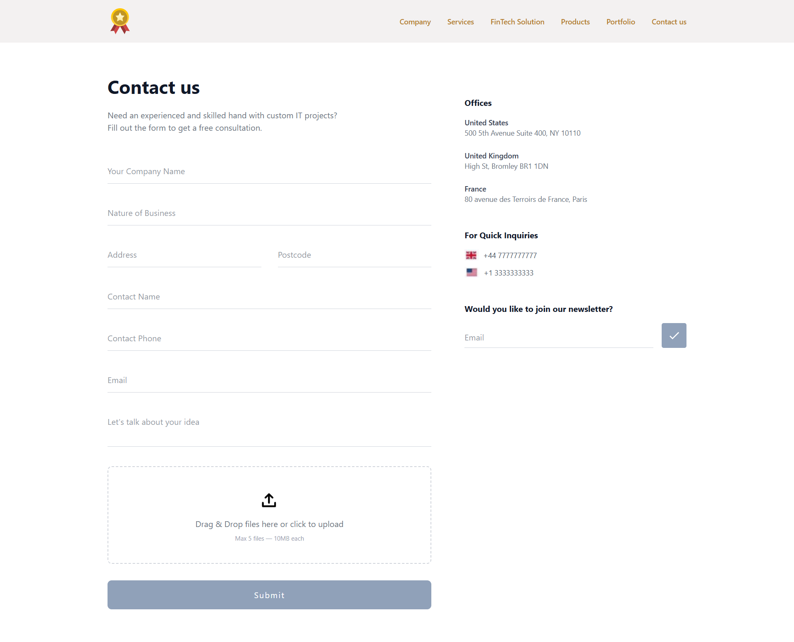

# 🚀 Advanced React UI Architecture & Modular Design

An advanced, modular UI system developed with a strong focus on **Performance**, **Accessibility**, and **Clean Code**.

## 📸 Project Preview



---

## ✨ Features

- Drag & Drop **file upload system**
- Image **preview generation**
- **Memory leak prevention** using URL cleanup
- **Data-driven UI rendering**
- **Reusable React components**
- **Responsive layout** with TailwindCSS
- **Email validation** with Regex
- **Accessible semantic HTML**

---

## 🏗 Project Architecture & Component Tree

This project follows a **Component-Based Architecture** where each module is independent, reusable, and testable.

```text
src/
 ├── assets/             # Static files (Images, SVGs)
 ├── components/         # Atomic & Molecular Components
 │    ├── Navbar/        # Navigation Logic
 │    ├── Sidebar/       # Contact & Newsletter Logic
 │    └── Upload/        # File Management Logic
 │
 ├── hooks/              # Custom Logic (if any)
 └── App.jsx             # Root Layout
```

## 🔍 Technical Deep-Dive

### 1. Memory Leak Prevention in File Previews

In the file upload section, `URL.createObjectURL` is used for image preview rendering. To prevent permanent RAM occupation, a **two-level cleanup mechanism** is implemented:

- **Manual Cleanup:** When a user manually removes a file from the list.
- **Lifecycle Cleanup:** Within the `useEffect` cleanup function when the component unmounts.

### 2. Data-Driven Approach (DRY Principle)

Instead of hardcoding HTML structures, all repetitive sections (Navbar links, office lists, contact numbers) are defined as **Object Arrays**. This approach enables:

- Adding new items without touching JSX.
- Cleaner, more readable code with smaller file sizes.

### 3. State Management Strategy

Controlled components are used for the email field, managing **four distinct states**:

| State        | Description                                    |
| ------------ | ---------------------------------------------- |
| `Idle`       | Initial state                                  |
| `Submitting` | Processing state with UI feedback (loading)    |
| `Success`    | Success message displayed after validation     |
| `Error`      | Error handling for validation failures (regex) |

---

## 🚦 Getting Started

### Prerequisites

- Node.js (v16+)
- npm / yarn

### Installation & Run

```bash
# 1. Clone the repo
git clone https://github.com/your-username/project-name.git

# 2. Install dependencies
npm install

# 3. Start development server
npm run dev
```


## 👨‍💻 Author

**Yekta (Frontend Developer)**

[](https://linkedin.com/in/yekta-akhavan)
[](https://github.com/yektaakhavan)
```
